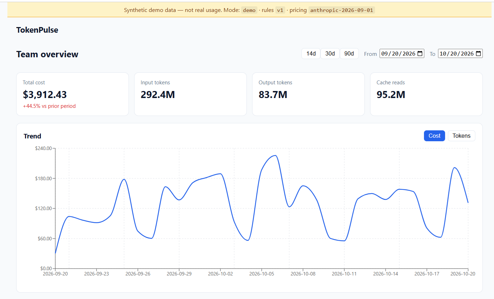
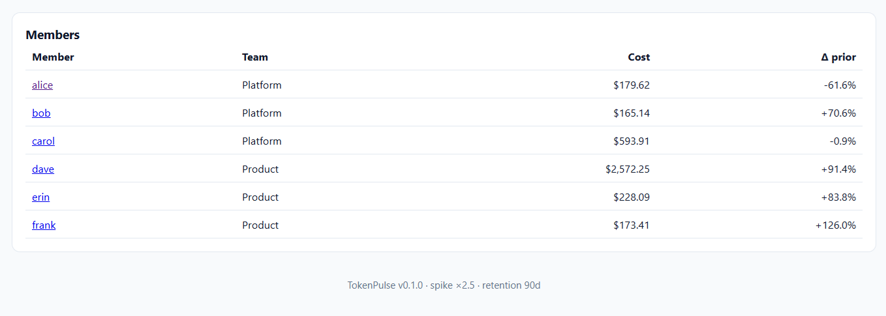
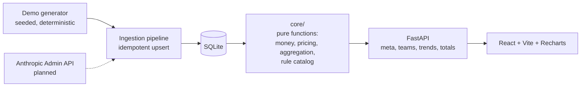

# TokenPulse

**See who on your team is spending what on Claude Code, and know when it spikes.**

TokenPulse is a small cost-and-usage monitor for engineering managers whose teams use Claude Code. It ingests daily token usage per person and per model, prices it, and shows trends for the team and for each member. The roadmap adds automatic spike detection and rule-based advice on how to cut cost.

> **Status: v1 in progress.** The zero-key demo dashboard (trends, totals, per-member views) is built and tested. Spike detection, recommendations and live Anthropic ingestion are specified and planned but **not built yet**. See [Status](#status).





*Screenshots use the built-in synthetic demo data (see the banner at the top of the page). No real usage is shown.*

---

## Why this exists

AI coding tools are now a real line item. Admins can see raw totals in the Anthropic Console, but a manager still can't easily answer:

- Is anyone's usage trending abnormally?
- Which model is driving the cost?
- What should we change to spend less without slowing people down?

TokenPulse is built to answer those questions at a glance, for a team of roughly 3 to 15 engineers.

## What works today

- **Zero-setup demo mode.** One command seeds 90 days of synthetic usage for 6 team members (1,620 records) and starts the app. No API keys needed.
- **Deterministic data.** The same seed produces byte-identical data, so demos and tests are reproducible.
- **Team dashboard.** Total cost, input/output/cache tokens, change versus the prior period, and a Cost/Tokens trend chart with 14/30/90-day and custom date ranges.
- **Per-member view.** Member table with cost and change versus prior period, plus a member detail page with a by-model breakdown.
- **Honest labelling.** A banner marks all demo data as synthetic, and the footer shows the active pricing table, rule version and spike threshold.

## Status

| Story | Scope | State |
|---|---|---|
| US1 | Zero-key demo mode with seeded synthetic data | Done |
| US2 | Trend dashboard (team and per member) | Done |
| US3 | Automatic spike detection (rolling 7-day baseline, 2.5x default) | Planned |
| US4 | Rule-based recommendations (model choice, prompt caching, batch API) | Planned |
| US5 | Live ingestion from the Anthropic Usage & Cost Admin API | Planned |

The demo data deliberately includes planted spikes and usage patterns (for example, one member running a more expensive model heavily). Today the dashboard makes that visible. US3 and US4 are what will explain it and suggest a fix.

## Quickstart

**Prerequisites:** Python 3.12, [uv](https://docs.astral.sh/uv/), Node.js 20+.

```bash
git clone https://github.com/chithraiyer/token-pulse.git
cd token-pulse
```

Then run the demo script for your platform:

```powershell
# Windows
./scripts/demo.ps1
```

```bash
# macOS / Linux
./scripts/demo.sh
```

The script seeds the demo database, starts the API on `http://127.0.0.1:8000` and the frontend on `http://localhost:5173`. Open the frontend URL in your browser.

### Running the tests

```bash
# Backend (from backend/)
uv run pytest tests/unit tests/contract tests/integration

# Frontend (from frontend/)
npm test
```

Current results: **62 backend tests** (47 unit, 10 contract, 5 integration) and **62 frontend tests** across 11 test files, plus a clean TypeScript build and lint.

### Troubleshooting (Windows)

If tests or the backend fail with *"An Application Control policy has blocked this file"*, Windows Smart App Control is rejecting an unsigned Python. Recreate the backend virtual environment against a signed python.org build of Python 3.12 rather than disabling the protection.

## Architecture



Key decisions:

- **Pure `core/` package.** Money math, pricing, aggregation and the rule catalog have no database or network imports. That keeps them easy to test first and keeps reports deterministic.
- **Integer micro-USD end to end.** Cost is stored and computed as whole millionths of a dollar, never floats, so rounding errors can't accumulate on the money path.
- **Versioned, dated pricing tables.** Estimates are labelled as estimates, and a report can always be traced to the pricing version that produced it.
- **Explainable rules over ML.** Every flag and recommendation will name its rule, its evidence and its projected saving. Same inputs and config give byte-identical reports.
- **Metadata only.** No prompt or completion content is ever stored.
- **SQLite for v1,** with encryption at rest planned for live mode. Postgres is a natural later step.

## How it was built

This project is a deliberate exercise in **spec-driven development with an AI coding agent**, using [GitHub Spec Kit](https://github.com/github/spec-kit) and Claude Code. The planning artifacts are in the repo so the reasoning is reviewable, not just the result:

| Phase | Artifact |
|---|---|
| Principles | `.specify/memory/constitution.md` (5 principles, including test-first money logic and determinism) |
| Specification | `specs/001-cost-usage-monitor/spec.md` (5 user stories, 37 functional requirements, 7 entities, 10 success criteria) |
| Plan | `specs/001-cost-usage-monitor/plan.md` |
| Tasks | `specs/001-cost-usage-monitor/tasks.md` (109 tasks) |
| Decisions | `docs/adr/0001-source-identity-field.md` |

I work as a product and engineering manager and had no prior hands-on web development experience. My role here was the one I'd play with a team: write the problem and the constraints, make the architecture calls, review what comes back, and refuse to accept "done" without evidence.

### What I reviewed and pushed back on

- **Deviations from my own principles are written down, not hidden.** The plan conflicted with the constitution in two places (a stored field beyond the approved list, and no auth or RBAC in a single-operator v1). Both are recorded in an ADR with the alternative that was rejected and the mitigations.
- **A referenced decision record didn't exist.** The plan pointed at an ADR that had never been written. I caught it and had it created before moving on.
- **"Written" is not "verified".** The agent flagged that the frontend had been authored but never built, because Node wasn't installed. I installed it and required a real build and test run before committing.
- **Passing tests is not coverage.** The first frontend run passed with a single test file. The agent flagged the gap itself, and the suite grew to 62 tests across every component.
- **Only the unit tests had been run.** I asked for the contract and integration suites separately and for raw output rather than a summary.
- **Generated files were tracked in git.** A TypeScript `composite` setting emitted build artifacts next to the source. The root cause was fixed in the config rather than just ignoring the files.
- **A security control blocked the tooling.** Windows Smart App Control rejected the managed Python. I chose to rebuild the environment on a signed interpreter instead of disabling the protection.
- **Scope was staged.** Rather than generating all 109 tasks at once, the first pass was limited to the stories that produce a demoable result (US1 and US2).

## Roadmap

- **Next:** spike detection (US3) and recommendations (US4)
- Live ingestion from the Anthropic Usage & Cost Admin API (US5), with encryption at rest
- OpenAI and Gemini usage ingestion on the same data model
- Slack alerts on spikes
- Weekly digest email with a narrative summary
- Team budget thresholds and forecasting
- Authentication, role-based access and an engineer self-service view

## Project structure

```
backend/      FastAPI app, pure core/ package, ingestion, persistence, tests
frontend/     React + Vite + Recharts dashboard and tests
scripts/      One-command demo launchers (PowerShell and shell)
specs/        Spec Kit specification, plan and tasks
docs/adr/     Architecture decision records
.specify/     Spec Kit constitution and templates
```

## License

Not yet specified.
